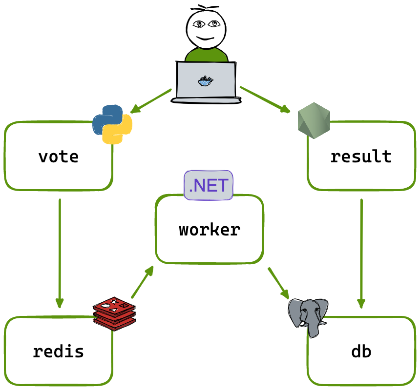

# Example Voting App — DevOps Practice Edition

All existing DevOps assets (Dockerfiles, Docker Compose/Swarm files, Kubernetes
manifests, GitHub Actions, Dependabot, healthcheck scripts, VS Code docker debug
config) have been removed. Only the application source remains, so you can build
the whole DevOps layer yourself.

## Architecture

| Service | Stack | Port | Needs |
|---|---|---|---|
| `vote` | Python / Flask (`vote/app.py`, gunicorn) | 80 | Redis |
| `redis` | Redis (not in repo — use the official image) | 6379 | — |
| `worker` | .NET 7 (`worker/Program.cs`) | none | Redis + Postgres |
| `db` | Postgres (not in repo — use the official image) | 5432 | — |
| `result` | Node.js / Express + socket.io (`result/server.js`) | 80 (`PORT` env) | Postgres |
| `seed-data` | Apache Bench scripts (`generate-votes.sh`, `make-data.py`) | — | `vote` |

Flow: browser -> `vote` -> Redis (list `votes`) -> `worker` -> Postgres -> `result` -> browser.

## Things the code expects (important for your DevOps setup)

- Hostnames are hardcoded: the app finds Redis at `redis` and Postgres at `db`,
  so your service names / DNS names must match.
- Postgres credentials are hardcoded: user `postgres`, password `postgres`, db `postgres`.
- `vote` listens on 80 (gunicorn: `gunicorn app:app -b 0.0.0.0:80`); optional env `OPTION_A` / `OPTION_B`.
- `result` listens on `PORT` env (default 4000).
- `worker` builds with `dotnet publish -c release`, output `Worker.dll`.
- `vote` image needs `curl` if you want an HTTP healthcheck.
- `seed-data/generate-votes.sh` calls `http://vote/` and needs `ab` (apache2-utils).
- Optional smoke test: `result/tests/tests.sh` + `render.js` (PhantomJS, old — modernize it, e.g. with Playwright).

## Practice checklist

**Docker**
- [ ] Write a Dockerfile for each of `vote`, `result`, `worker` (try multi-stage builds, non-root user, `.dockerignore`)
- [ ] Optional Dockerfile for `seed-data`
- [ ] Write `docker-compose.yml` with healthchecks, networks (front/back tier), volume for Postgres, `depends_on` conditions

**CI/CD**
- [ ] GitHub Actions or Jenkins pipeline: build, test, image scan (Trivy), push to registry (Docker Hub/ECR)
- [ ] Path-based triggers per service
- [ ] Dependabot / Renovate for dependencies

**Kubernetes**
- [ ] Deployments + Services for all five components (NodePort/Ingress for vote and result)
- [ ] Postgres with PVC instead of emptyDir, Secrets for credentials, ConfigMaps
- [ ] Liveness/readiness probes, resource limits, HPA / KEDA

**Extras**
- [ ] Helm chart or Kustomize
- [ ] Terraform for infra (EKS/ECS)
- [ ] Prometheus + Grafana / CloudWatch monitoring
- [ ] Playwright E2E test stage in the pipeline
